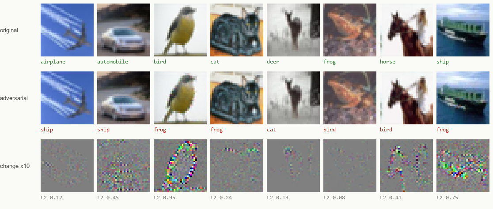
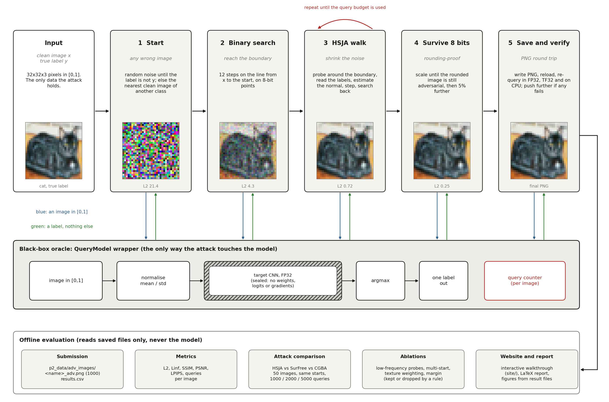
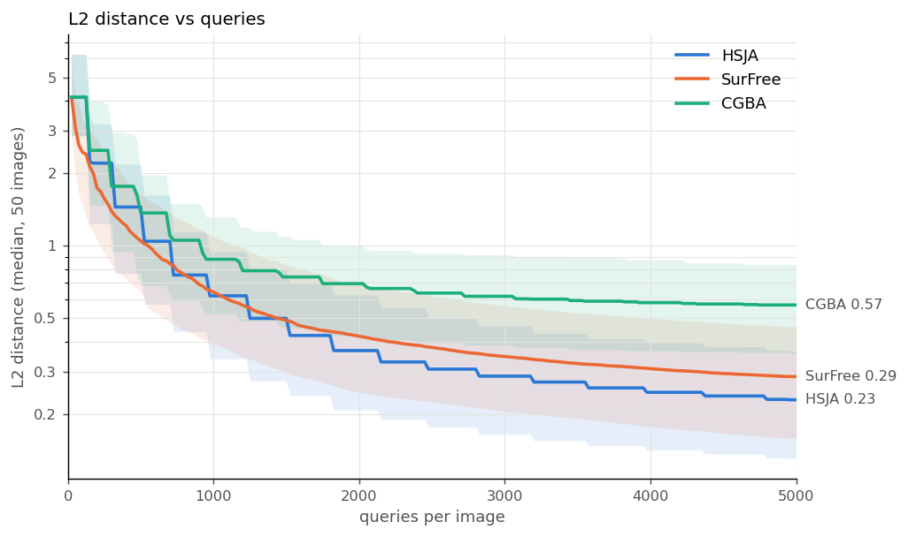

# FOOLML

Hard-label black-box adversarial attack on a CIFAR-10 CNN. The model only ever tells us its top-1 label, nothing else.
We perturb all 1000 test images so the model misclassifies every one, while keeping the change at an average L2 of 0.36
(SSIM 0.998) after saving to 8-bit PNG.



Project write-up with an interactive walkthrough of the attack: **https://akshitag001.github.io/FOOLML/** (source in [`site/`](site/)).

## Results

Final submission, all 1000 images, measured on the saved PNGs:

| success | L2 | L∞ | SSIM | PSNR | LPIPS | queries / image |
|---|---|---|---|---|---|---|
| **1000 / 1000** | 0.363 | 0.061 (15.6/255) | 0.9977 | 45.9 dB | 0.00019 | 4956 |

Checked in a fresh process with the model loaded exactly as the competition template does: 1000/1000 misclassified on GPU and
on CPU, in one batch of 1000. Per-image numbers are in [`results.csv`](results.csv).

The averages hide a spread: median L2 is 0.325, the 90th percentile 0.68, the largest 1.38. 734 of the 1000 images have some pixel changed
by more than 8/255 and 405 by more than 16/255 (median per-image L∞ 14/255, worst 54/255). LPIPS uses the AlexNet backbone and is computed
from the saved PNGs only. After the attack the model most often predicts frog (258 images) and bird (228); horse (18) and automobile (21)
are rare. Everything above comes from [`results/final/`](results/final/) and is produced by [`report/extra_metrics.py`](report/extra_metrics.py).

### Architecture



Every arrow into the model goes through one wrapper that returns a label and counts the query. The bottom row only reads saved files.
Figures are regenerated from the result files with `python report/make_figures.py`.

A 7-page write-up of what we tried, what failed and the bugs we hit is in [`report/report.pdf`](report/report.pdf)
(source: [`report/report.tex`](report/report.tex)).

### Attack comparison

Same 50 images (5 per class), same starting points, same per-image query budgets. Budgets include the ~14 queries spent finding
the starting point.

| budget | HSJA | SurFree | CGBA |
|---|---|---|---|
| 1000 | **0.727** | 0.833 | 1.083 |
| 2000 | **0.464** | 0.522 | 0.832 |
| 5000 | **0.288** | 0.356 | 0.682 |

*Mean L2 at each budget. 100% success for every cell. The baseline starting point alone is at L2 4.64.*



SurFree converges faster in the first ~700 queries; HSJA wins after that. CGBA (our port, with the reference CIFAR-10 settings)
plateaus around 0.6.

## Setup

- **Target:** a TorchScript CNN (`p2_data/cnn_model.pt`) that maps a normalized 32×32 image to a class index.
- **Allowed:** query the model, read the predicted label.
- **Not allowed:** weights, architecture, intermediate activations, logits, probabilities, gradients.
- **Scoring:** 50% attack success rate, 50% imperceptibility. Ties go to fewer queries and a larger confidence change.
- **Output:** one PNG per clean image, `cat_5.png` → `cat_5_adv.png`, in `p2_data/adv_images/`.

All model access goes through a small `QueryModel` wrapper: it takes images in [0, 1], normalizes them, returns labels only, and
counts every query per image. None of the attacks touch the model directly.

## How it works

1. **Start.** Draw uniform noise until the model calls it something other than the true class (up to 10 tries). If that fails,
   use the nearest clean image the model assigns to another class.
2. **Binary search** from the clean image toward that start, 12 steps, testing only 8-bit-quantized points.
3. **HopSkipJumpAttack** ([Chen et al. 2020](https://arxiv.org/abs/1904.02144)), untargeted L2. Estimate the boundary normal from
   `100·√t` label-only probes, take a geometric step, then binary-search back to the boundary. Our implementation is written from the
   paper and reference code, so it can only call the wrapper.
4. **Make it survive PNG.** Attacks run in continuous space, and rounding to 0–255 can undo them. For a few images HSJA finds an L2 of about
   0.001, smaller than one 1/255 step on one pixel. So the result is scaled outward along clean → adversarial until the *rounded* image
   is still adversarial, refined with a short binary search, then pushed 5% further as a safety margin.
5. **Save and re-verify.** Write PNGs, reload them, re-query. Anything that fails, in FP32, with TF32, on CPU or at a different batch
   size, gets pushed further and re-saved. On the final run 2 of 1000 needed this.

Final config: HSJA + texture-weighted probe directions + 5% margin, 5000 queries per image. Runtime is 24 minutes for 1000 images
on an RTX 4070.

### What we tried on top of HSJA

Each change was tested on the same 50 images at 5000 queries, on top of the ones kept before it.

| change | L2 | SSIM | kept |
|---|---|---|---|
| HSJA baseline (1% margin) | 0.288 | 0.9969 | |
| low-frequency probes (16×16 / 8×8 DCT) | 0.467 / 0.892 | 0.9929 / 0.9794 | no |
| best of 10 starting points | 0.295 | 0.9970 | no |
| texture-weighted probes, p = 1 | 0.365 | 0.9979 | yes |
| 5% margin instead of 1% | 0.379 | 0.9977 | yes |

Notes:
- Low-frequency probes made things worse on 32×32 images.
- Better starting points were 22% closer but gave the same final result: HSJA forgets where it started.
- Texture weighting was kept on an SSIM-first rule. It costs about 27% in L2, so if the imperceptibility metric turns out to be L2,
  drop it (`FINAL["opts"]["texture"] = None`) and expect L2 ≈ 0.30.
- The margin matters for robustness. With 0% margin, 2 of 50 images flip back under TF32 or on CPU. With 5%, all hold, and 94% survive
  random ±1/255 jitter (34% at 0%).

## Things that bit us

- **TF32 makes labels depend on batch size.** On Ampere/Ada GPUs PyTorch runs convolutions in TF32 by default. For points right at
  the boundary, the same image got different labels alone vs in a batch of 20. That's fatal for a binary search. The oracle
  now runs in full FP32 (`torch.backends.cudnn.allow_tf32 = False`), and the final images are verified with TF32 back on.
- **`(x * 255).astype(uint8)` truncates.** Even with zero perturbation it shifted 14% of pixel values. Use `round()`.
- **Searching toward a far point isn't monotone.** Our first rounding fix binary-searched from the HSJA point toward the starting point.
  The decision regions aren't convex, so it sometimes slid nearly all the way back (L2 0.7 → 4.3). Scaling outward along the
  clean → adversarial ray fixed it.

## Repository layout

```
p2_code.ipynb            the whole pipeline (helpers, baseline, HSJA, SurFree, CGBA, study, final run, website export)
p2_data/
  clean_images/          1000 CIFAR-10 test images from the organisers (100 per class)
  adv_images/            our 1000 adversarial PNGs, the submission
  cnn_model.pt           target model (TorchScript)
results.csv              per-image metrics for the final run (L2, Linf, SSIM, PSNR, LPIPS, queries)
report/                  LaTeX report + PDF, make_figures.py (all figures and tables from the result files), extra_metrics.py
results/
  final/                 final summary, checkpoints, figures
  compare50/             HSJA vs SurFree vs CGBA (JSON summaries, images, L2 traces, plot)
  study50/               improvement study (one JSON per step, chosen config)
  baseline*/ hsja_*/     early 20-image runs
site/                    static project website (GitHub Pages)
```

## Reproducing

```
pip install -r requirements.txt
jupyter nbconvert --to notebook --execute --inplace p2_code.ipynb
```

Or open the notebook and run it top to bottom. The organisers' setup cell (untouched) extracts `p2_data.zip`. On a fresh clone there is no
zip, so cell 2 rebuilds an identical one from the `p2_data/` folder in the repo.

| part | time on an RTX 4070 | notes |
|---|---|---|
| attack comparison | ~25 min | cached in `results/compare50/`; set `RERUN_COMPARISON = True` to redo |
| improvement study | ~12 min | cached in `results/study50/`; set `RERUN_STUDY = True` to redo |
| final run, 1000 images | ~24 min | checkpoints every 100 images in `results/final/checkpoints/`; re-running skips finished chunks |
| everything else | ~5 min | |
| extra metrics, figures, report | ~1 min | `python report/extra_metrics.py && python report/make_figures.py`, then `cd report && latexmk -pdf report.tex` |

All runs are seeded. The first two cells marked `DO NOT EDIT THIS CELL` come from the organisers and are untouched.

To view the website locally:

```
cd site
python -m http.server 8000
```

Then open http://localhost:8000. Opening `index.html` directly won't work, because browsers block `fetch()` from `file://`.

## References

- Chen, Jordan, Wainwright. [HopSkipJumpAttack: A Query-Efficient Decision-Based Attack](https://arxiv.org/abs/1904.02144). IEEE S&P 2020.
- Maho, Furon, Le Merrer. [SurFree: a fast surrogate-free black-box attack](https://arxiv.org/abs/2011.12807). CVPR 2021. Reference code: [t-maho/SurFree](https://github.com/t-maho/SurFree)
- Reza, Rahmati, Wu, Bayat. [CGBA: Curvature-aware Geometric Black-box Attack](https://arxiv.org/abs/2308.03163). ICCV 2023. Reference code: [machanic/hard_label_attacks](https://github.com/machanic/hard_label_attacks)
- Brendel, Rauber, Bethge. [Decision-Based Adversarial Attacks](https://arxiv.org/abs/1712.04248). ICLR 2018.
- Cheng et al. [Sign-OPT](https://arxiv.org/abs/1909.10773). ICLR 2020.
- Rahmati et al. [GeoDA](https://arxiv.org/abs/2003.06468). CVPR 2020.

The dataset images are from CIFAR-10 (Krizhevsky, 2009) as distributed by the hackathon organisers, together with the target model.
